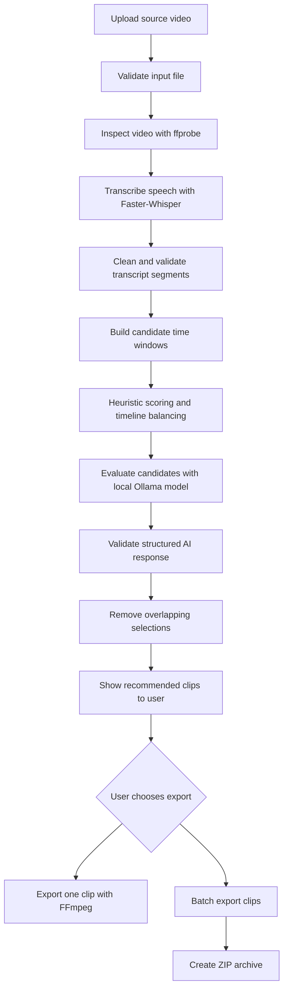

<!--
Clipty Mini v1
Repository: https://github.com/kaliprogramer/Clipty-mini-v1

README image guidance:
- The banner below points to the banner already stored in utils/.
- Add your preferred application screenshots under assets/screenshots/ and
  replace the screenshot placeholders in the "Application Screenshots" section.
-->

<p align="center">
  
</p>

<h1 align="center">Clipty Mini v1</h1>

<p align="center">
  <strong>Find the moments worth sharing. Turn long videos into focused, ready-to-export clips.</strong>
</p>

<p align="center">
  <a href="https://github.com/kaliprogramer/Clipty-mini-v1">
    
  </a>
  
  
  
  
</p>

<p align="center">
  <a href="#overview">Overview</a> ·
  <a href="#features">Features</a> ·
  <a href="#how-it-works">How It Works</a> ·
  <a href="#installation">Installation</a> ·
  <a href="#configuration">Configuration</a> ·
  <a href="#roadmap">Roadmap</a>
</p>

---

## Overview

**Clipty Mini v1** is a locally run, AI-assisted video clipping application. It analyzes the spoken content of an uploaded video, identifies promising sections, evaluates those sections for standalone viewing quality, and lets the user export individual clips or a complete batch.

The application combines speech recognition, transcript-based candidate generation, local language-model evaluation, and FFmpeg rendering in one Gradio interface.

Clipty Mini is designed around a practical editing workflow: the AI recommends moments, explains why they may work as clips, and the user decides what to export. It is an assistant for highlight discovery, not an autonomous replacement for an editor.

### Project goals

- Reduce the time spent manually reviewing long videos for usable moments.
- Keep AI analysis local through Ollama rather than requiring a paid hosted LLM API.
- Make clip selection configurable instead of relying on one fixed duration or model.
- Export clips in landscape/original format or vertical layouts for short-form platforms.
- Keep the processing pipeline separated into modules that can be maintained and extended.

> **Current scope:** Clipty Mini selects moments from speech transcripts. It does not currently understand every visual event in a video, track faces, or automatically reframe a moving subject.

---

## Application Screenshots

Add or replace screenshots in `assets/screenshots/`. The image references below are intentionally left as placeholders for your preferred captures.

### Main application

<!-- Replace the path below after adding your homepage screenshot. -->
<p align="center">
  
</p>

### AI-selected highlights

<!-- Replace the path below with a screenshot of the AI Best Moments panel. -->
<p align="center">
  
</p>

### Transcript and video metadata

<!-- Replace the path below with a screenshot of the transcript and metadata panels. -->
<p align="center">
  
</p>

### Export settings

<!-- Replace the path below with a screenshot of the clip export settings. -->
<p align="center">
  
</p>

---

## Features

| Feature | What it does | Why it matters |
|---|---|---|
| Video upload and validation | Accepts a video file and checks that it exists and uses a supported extension. | Prevents the processing pipeline from starting with an invalid input. |
| Technical metadata inspection | Reads duration, resolution, aspect ratio, frame rate, codec, file size, and bitrate through `ffprobe`. | Gives the user useful information about the source before exporting. |
| Speech-to-text transcription | Uses Faster-Whisper to convert spoken audio into timestamped transcript segments. | Provides the text and timing needed for transcript-based highlight discovery. |
| Voice activity detection | Enables the VAD filter during transcription. | Helps the transcription engine focus on speech rather than long non-speech intervals. |
| Local AI model selection | Checks the configured Ollama server and discovers locally available models. | Lets users choose a model that fits their hardware and quality requirements. |
| Candidate highlight generation | Builds duration-constrained windows from consecutive transcript segments. | Gives the AI complete sections of speech to evaluate instead of arbitrary tiny fragments. |
| AI highlight evaluation | Uses an Ollama language model to assess hooks, context, coherence, and endings. | Prioritizes moments that can make sense to a viewer who has not watched the full video. |
| Heuristic pre-scoring | Scores transcript candidates using signals such as hook vocabulary, questions, pacing, sentence endings, and filler words. | Narrows the candidate pool before the more expensive model evaluation. |
| Timeline-balanced candidate selection | Samples promising candidates across the video timeline. | Reduces the chance that all suggested clips come from one small section. |
| Clip validation and de-duplication | Validates model output and removes substantially overlapping selections. | Keeps the final list usable and avoids exporting near-duplicate moments. |
| Manual result selection | Lets the user select a result from the AI highlights table. | Keeps the final export decision under human control. |
| Configurable clip settings | Allows minimum and maximum duration, maximum clip count, and minimum AI score to be adjusted. | Adapts selection to different content formats and editing needs. |
| Export layout options | Supports original aspect ratio, vertical 9:16 with a blurred background, and vertical 9:16 center crop. | Produces landscape clips or common short-form vertical formats. |
| Video encoding controls | Exposes CRF quality and an optional audio loudness-normalization setting. | Gives users control over output quality and audio consistency. |
| Single-clip export | Renders one selected highlight as an MP4 file. | Makes it easy to review or publish one moment at a time. |
| Batch export and ZIP packaging | Renders the available selected highlights and bundles successful exports into a ZIP archive. | Simplifies downloading and organizing multiple clips. |
| Progress and status feedback | Reports the main processing stages and export progress in the interface. | Makes longer-running operations easier to follow. |
| Structured configuration | Uses Pydantic models to validate transcription, selection, and export settings. | Keeps configuration explicit and catches invalid values early. |
| Logging | Records application and processing events through a shared logger. | Helps diagnose model, transcription, and export failures. |

---

## How It Works

Clipty Mini follows a staged pipeline. Speech recognition provides timestamped text; the selection engine proposes and evaluates candidate windows; FFmpeg renders the selected time ranges.



### 1. Upload and inspect

The user uploads a source video. Clipty resolves the uploaded file path, checks that the file exists, and uses `ffprobe` to read its technical properties.

The metadata stage collects:

- Video duration
- Width and height
- Resolution and aspect ratio
- Frame rate
- Video codec
- File size
- Bitrate

This information is displayed in the interface so the source media can be inspected before export.

### 2. Transcribe speech

The transcription engine uses **Faster-Whisper**, a CTranslate2-based implementation of Whisper.

The engine returns transcript segments containing:

```json
[
  {
    "start": 12.40,
    "end": 16.85,
    "text": "This is the example spoken in the video."
  }
]
```

Each segment retains its original time boundaries. Those timestamps are important because the later selection and export stages use them to locate the corresponding section of the source video.

### 3. Generate candidate windows

The selection engine cleans and sorts transcript segments, then combines consecutive segments into candidate windows within the configured minimum and maximum duration.

Candidate windows are not selected solely by keyword matching. The engine also considers speech structure and transcript boundaries so that a candidate can contain a complete thought.

### 4. Rank candidates before AI evaluation

A lightweight heuristic scoring stage evaluates transcript signals, including:

- Attention-grabbing vocabulary
- Questions and curiosity signals
- Conversational pacing
- Sentence completion
- Filler-word frequency

The candidate pre-selection stage distributes its selection across the source video's timeline. This helps the system consider moments from different parts of a long video rather than concentrating only on one region.

### 5. Evaluate moments with Ollama

The selected candidates are sent to a locally running Ollama model. The model is instructed to evaluate four criteria:

| Evaluation criterion | Question the model considers |
|---|---|
| Opening hook | Does the clip begin with something that can capture attention? |
| Standalone context | Can a new viewer understand the subject without the full video? |
| Coherent middle | Does the section follow a logical and engaging progression? |
| Ending payoff | Does it finish a thought, reveal something, or deliver a clear takeaway? |

The model returns structured JSON that is validated using Pydantic schemas. Each accepted selection includes a candidate ID, title, reason, score, and evaluation flags.

The application then checks the selected candidate IDs, applies the configured score and duration requirements, and removes substantially overlapping clips.

**Fallback behavior:** If Ollama evaluation is unavailable or fails, the selection engine includes a heuristic fallback path. Fallback recommendations are based on transcript signals and should not be interpreted as equivalent to full language-model evaluation.

### 6. Review and export

The interface presents the transcript, video metadata, and recommended moments. The user can select a clip and export it, or run a batch export.

FFmpeg handles the actual media rendering:

- **Original:** preserves the source aspect ratio.
- **Vertical blur:** creates a 9:16 frame with a blurred background and a fitted foreground video.
- **Vertical crop:** fills a 9:16 frame by scaling and center-cropping the source.

The export engine can also apply optional loudness normalization, encode video with H.264, encode audio with AAC, and package batch results into a ZIP archive.

---

## Technology Stack

| Technology | Role in Clipty Mini | Why it was chosen |
|---|---|---|
| Python 3.11+ | Main application language | Provides a mature ecosystem for AI inference, media processing, and application development. |
| Gradio 6 | User interface | Makes it possible to build an interactive Python-first application without maintaining a separate frontend and backend. |
| Faster-Whisper | Speech recognition | Provides timestamped transcription with efficient CTranslate2 inference and CPU/GPU support. |
| Ollama | Local LLM runtime | Runs language models on the user's machine and exposes a local API for AI evaluation. |
| Qwen 2.5 (configurable) | Highlight evaluation model | Provides instruction-following and structured-response capabilities suitable for evaluating transcript candidates. The exact model is selected by the user from installed Ollama models. |
| Pydantic v2 | Data models and validation | Defines typed configuration and validates structured AI responses before they are used. |
| FFmpeg | Clip rendering and encoding | Provides reliable media trimming, scaling, cropping, filtering, audio processing, and encoding. |
| ffprobe | Media inspection | Extracts source video and container metadata for display and validation. |
| CTranslate2 | Whisper inference backend | Supports efficient model execution and configurable compute precision. |
| `uv` | Python environment and dependency management | Creates reproducible environments and installs dependencies from the project configuration and lockfile. |

### Why local AI?

Clipty Mini uses a local Ollama service for language-model evaluation instead of requiring a hosted LLM API key.

This design offers several advantages:

- No per-request hosted LLM API charge for the local selection step.
- Video transcripts can be evaluated by a model running on the user's machine.
- Users can switch between installed Ollama models.
- The application can be used without sending transcript content to a third-party LLM API.

Local inference still consumes system resources. Model size, RAM, CPU/GPU capability, and video length affect processing time. Local AI does not mean that computation is free of hardware cost.

> Faster-Whisper downloads its selected model files when they are not already cached. Ollama models must also be downloaded separately. An internet connection is therefore normally needed during initial setup, even though the analysis workflow can run locally after the required models are installed.

---

## Project Structure

The repository is organized into an application entry point, core processing modules, shared helpers, and supporting assets.

```text
Clipty-mini-v1/
│
├── app.py
│
├── core/
│   ├── config.py
│   ├── transcriber.py
│   ├── ollama_service.py
│   ├── clip_manager.py
│   └── video_processor.py
│
├── helper/
│   ├── __init__.py
│   ├── logger.py
│   └── print_log.py
│
├── utils/
│   ├── Clipty Mini v1_ AI Video Clipping-banner.png
│   └── ... application screenshots
│
├── video-sample/
│   └── ... sample media files
│
├── storage/
│   └── video_output/
│       └── ... generated clips and ZIP archives
│
├── test_pipeline.py
├── pyproject.toml
├── uv.lock
├── .gitignore
└── README.md
```

`storage/` is created or populated at runtime as the application writes exported media. The exact files present in that directory depend on the user's processing sessions.

### Module responsibilities

| File | Responsibility |
|---|---|
| `app.py` | Builds the Gradio interface and coordinates the complete user workflow: upload, model refresh, analysis, result selection, single export, and batch export. |
| `core/config.py` | Defines `LayoutMode`, `TranscriptionConfig`, `ClipSelectionConfig`, and `ExportConfig`. It centralizes defaults, allowed ranges, and configuration validation. |
| `core/transcriber.py` | Loads and reuses Faster-Whisper models, resolves automatic CPU/CUDA and compute-type settings, transcribes media, and returns timestamped text segments. |
| `core/ollama_service.py` | Checks whether the Ollama server is reachable, discovers installed models, reports connection status, and creates an Ollama client. |
| `core/clip_manager.py` | Cleans transcript data, builds candidate windows, calculates heuristic scores, balances candidates across the timeline, requests structured LLM evaluation, validates results, applies fallback ranking, and removes overlapping clips. |
| `core/video_processor.py` | Validates supported media files, reads metadata with `ffprobe`, renders clips with FFmpeg, applies layout and audio options, and creates ZIP archives. |
| `helper/logger.py` | Provides the shared application logger used by the processing modules. |
| `helper/print_log.py` | Contains small logging/console-output helper functionality. |
| `test_pipeline.py` | Provides a project-level pipeline test or diagnostic entry point. |
| `pyproject.toml` | Declares the Python version requirement and direct project dependencies. |
| `uv.lock` | Locks the resolved dependency versions for repeatable installation. |

---

## Installation

### Prerequisites

Install the following before starting Clipty Mini:

| Requirement | Purpose |
|---|---|
| Python 3.11 or newer | Runs the application and its dependencies. |
| `uv` | Manages the Python environment and dependencies. |
| FFmpeg and ffprobe | Inspect, trim, transform, and encode video files. |
| Ollama | Runs the local language model used for highlight evaluation. |
| An Ollama model | Evaluates candidate highlights. |

### 1. Clone the repository

```bash
git clone https://github.com/kaliprogramer/Clipty-mini-v1.git
cd Clipty-mini-v1
```

### 2. Install `uv`

If `uv` is not installed, follow the official installation instructions:

https://docs.astral.sh/uv/getting-started/installation/

Verify the installation:

```bash
uv --version
```

### 3. Install FFmpeg

On Ubuntu or Debian-based Linux:

```bash
sudo apt update
sudo apt install ffmpeg
```

Verify that both commands are available:

```bash
ffmpeg -version
ffprobe -version
```

For Windows and macOS, install FFmpeg using the instructions at:

https://ffmpeg.org/download.html

Make sure the FFmpeg executable directory is available on your system `PATH`.

### 4. Install Python dependencies

From the repository root:

```bash
uv sync
```

This creates or updates the project environment and installs the dependencies declared by the project.

### 5. Install and start Ollama

Install Ollama using its official instructions:

https://ollama.com/download

Start the Ollama service if it is not already running:

```bash
ollama serve
```

In another terminal, download a model. For example:

```bash
ollama pull qwen2.5:1.5b
```

A larger model may provide stronger evaluation quality but generally requires more memory and processing power:

```bash
ollama pull qwen2.5:7b
```

Check the models available locally:

```bash
ollama list
```

Clipty Mini's model selector can discover models exposed by the Ollama server. The selected model must already be installed locally.

### 6. Launch Clipty Mini

From the project root:

```bash
uv run app.py
```

Open the local Gradio URL printed in the terminal. The default Gradio launch address is typically:

```text
http://127.0.0.1:7860
```

---

## Configuration

Clipty Mini exposes processing settings through typed Pydantic configuration models. The application provides controls for the main selection and export options.

### Transcription settings

| Setting | Default | Description |
|---|---:|---|
| `model_size` | `tiny` | Faster-Whisper model size. Available choices depend on the installed Faster-Whisper/CTranslate2 model support. |
| `device` | `auto` | Selects automatic device resolution, CPU, or CUDA. |
| `compute_type` | `auto` | Resolves compute precision automatically. The implementation selects `float16` for CUDA and `int8` for CPU when using `auto`. |
| `cpu_threads` | `2` | Number of CPU threads used for transcription. |
| `language` | `None` | Optional language code. `None` allows language detection. |
| `vad_filter` | `True` | Enables voice activity detection. |

### AI selection settings

| Setting | Default | Description |
|---|---:|---|
| `ollama_model` | `qwen2.5:7b` | Ollama model used for candidate evaluation. |
| `ollama_host` | `http://127.0.0.1:11434` | Ollama server address. |
| `min_clip_duration` | `15` seconds | Minimum allowed candidate duration. |
| `max_clip_duration` | `60` seconds | Maximum allowed candidate duration. |
| `max_clips` | `5` | Maximum number of selected clips. |
| `min_score` | `7/10` | Minimum AI score required for a candidate. |
| `max_candidates` | `12` | Maximum number of balanced candidates sent for AI evaluation. |

The configuration validates duration ranges and rejects a minimum duration that is greater than or equal to the maximum duration.

### Export settings

| Setting | Default | Description |
|---|---:|---|
| `layout` | `original` | Output layout: original, vertical blur, or vertical crop. |
| `crf` | `23` | H.264 quality setting. Lower values generally produce higher quality and larger files. |
| `preset` | `veryfast` | FFmpeg x264 encoding-speed/compression preset. |
| `audio_bitrate` | `128k` | AAC audio bitrate. |
| `normalize_audio` | `False` | Enables FFmpeg loudness normalization when requested. |

### Ollama server address

The default local Ollama address is:

```text
http://127.0.0.1:11434
```

If Ollama is running on a different machine or port, use the corresponding server address in the application's model settings. Ensure the server is reachable from the machine running Clipty Mini.

---

## Hardware and Performance

Clipty Mini can use CPU inference and can automatically select CUDA when a compatible CUDA device is available. Actual performance depends on the source video, selected Whisper model, Ollama model, available memory, and processor/GPU.

| Component | Performance considerations |
|---|---|
| Faster-Whisper | Smaller models generally use fewer resources and run faster; larger models can improve transcription quality at additional cost. |
| Ollama | Small quantized models are more practical on limited hardware. Larger models may need substantially more RAM or VRAM. |
| FFmpeg | Video encoding can be CPU-intensive, especially for high-resolution sources and vertical filters. |
| Storage | Keep sufficient free disk space for uploaded source videos, exported clips, and batch archives. |

### Practical starting point for CPU-only machines

- Start with the `tiny` or `base` Whisper model.
- Try a smaller Ollama model such as `qwen2.5:1.5b`.
- Keep the number of candidate windows and exported clips modest.
- Close memory-heavy applications while processing large videos.
- Use the original layout when a vertical conversion is not required.

These are starting points, not performance guarantees. A machine's available RAM, CPU, and video characteristics will determine the actual experience.

---

## Supported Media and Output

### Input formats

The video validation layer currently recognizes these file extensions:

`MP4`, `MOV`, `MKV`, `WEBM`, `AVI`, `FLV`, `M4V`, `TS`, and `WMV`.

Successful processing also depends on the codecs and streams inside the media container being readable by the installed FFmpeg build.

### Export formats and layouts

| Output | Description | Typical use |
|---|---|---|
| MP4, original layout | Preserves the source aspect ratio. | Landscape clips and general-purpose video. |
| MP4, vertical blur | Renders a 9:16 frame with a blurred background and fitted foreground. | Shorts, Reels, and TikTok-style vertical video. |
| MP4, vertical crop | Renders a 9:16 frame using a center crop. | Vertical video when a center crop is suitable. |
| ZIP archive | Bundles successfully exported batch clips. | Downloading and organizing a group of highlights. |

Vertical crop and blur layouts are geometric transformations. They do not currently perform face tracking or intelligent subject-aware reframing.

---

## Output Files

Generated media is written under:

```text
storage/
└── video_output/
    ├── clip_01_original_<id>.mp4
    ├── clip_02_vertical_blur_<id>.mp4
    ├── batch_<id>/
    │   ├── clip_01_....mp4
    │   └── clip_02_....mp4
    └── clipty_clips_<id>.zip
```

The exact names and number of files depend on the export operation and selected layout. Keep this directory available until you have moved or backed up the clips you want to keep.

---

## Limitations

Clipty Mini v1 is focused on transcript-driven highlight discovery and practical clip export. The following limitations are important to understand:

1. **Speech-dependent selection:** The AI highlight-selection pipeline requires a usable transcript. Videos with no audible speech or no valid transcript segments cannot be evaluated by the current workflow.
2. **Transcript-based understanding:** The selection model evaluates spoken content. It does not currently analyze visual storytelling, facial expressions, gestures, scene changes, or on-screen events.
3. **No automatic face tracking:** Vertical layouts use blur or center-crop transformations, not face-aware or object-aware tracking.
4. **Model-dependent results:** Highlight quality depends on transcription accuracy, transcript context, the selected Ollama model, and the configured thresholds.
5. **No virality guarantee:** Scores and recommendations are automated estimates, not predictions of actual audience retention or social-media performance.
6. **Local resource usage:** Transcription, local LLM inference, and video encoding can be slow on low-resource systems.
7. **First-run downloads:** Whisper model files and Ollama models may need to be downloaded before offline use.
8. **Human review is recommended:** Always preview exported clips before publishing, especially when a clip depends on context, sensitive subject matter, or precise wording.

---

## Roadmap

The checklist below tracks possible future development. Items are intentionally unchecked and should only be marked complete when they are implemented and verified.

### Video understanding and editing

- [ ] Visual scene analysis in addition to transcript analysis.
- [ ] Face detection and subject tracking.
- [ ] Intelligent vertical reframing that keeps the active speaker or subject in view.
- [ ] Scene-change and visual-event detection.
- [ ] More precise clip boundary refinement.
- [ ] Optional subtitle generation and subtitle styling.
- [ ] More export aspect ratios and platform-specific presets.

### AI selection improvements

- [ ] Chunked transcript analysis for very long videos.
- [ ] Better context preservation across transcript chunks.
- [ ] User-defined highlight styles, such as educational, funny, dramatic, or informative.
- [ ] More detailed selection explanations and confidence indicators.
- [ ] Improved evaluation benchmarks using manually reviewed clips.

### Workflow and application

- [ ] Persistent project history and reusable editing sessions.
- [ ] Clip preview and timeline refinement before export.
- [ ] Queue management for multiple source videos.
- [ ] More detailed export progress and error reporting.
- [ ] Configuration profiles for different hardware capabilities.
- [ ] Automated tests for transcription, candidate selection, validation, and export.

### Distribution

- [ ] Packaged desktop application.
- [ ] Cross-platform installation and update workflow.
- [ ] User and developer documentation improvements.

---

## Troubleshooting

### Ollama is unreachable

Make sure the Ollama service is running:

```bash
ollama serve
```

Then verify that the server responds and that a model is installed:

```bash
ollama list
```

If Ollama uses a custom host or port, update the host in the application's model settings.

### No Ollama models appear

Download a model first:

```bash
ollama pull qwen2.5:1.5b
```

Refresh the model list in Clipty Mini after the download finishes.

### FFmpeg or ffprobe not found

Check that both executables are installed and available on `PATH`:

```bash
ffmpeg -version
ffprobe -version
```

Install the FFmpeg package for your operating system if either command is missing.

### No highlights are returned

Try the following:

- Confirm that the source contains clear spoken dialogue.
- Check that the transcript contains valid segments.
- Widen the minimum and maximum clip-duration range.
- Lower the minimum score threshold.
- Increase the candidate limit if the selection configuration allows it.
- Try a stronger Ollama model if your hardware can run one.

A stricter selection threshold can legitimately return fewer clips. The application should not invent highlights simply to fill the requested count.

### Processing is slow

- Use a smaller Whisper model.
- Use a smaller Ollama model that fits available memory.
- Avoid running several heavy inference tasks at the same time.
- Check available RAM and CPU usage.
- Remember that FFmpeg encoding time depends on source resolution, duration, filters, and encoding settings.

---

## Development and Testing

Install the project dependencies:

```bash
uv sync
```

Run the application:

```bash
uv run app.py
```

The repository also includes a pipeline test/diagnostic script:

```bash
uv run python test_pipeline.py
```

The test script may require the same local dependencies, FFmpeg installation, and model/runtime setup as the application. Review the script before running it if you are working in a modified environment.

---

## Contributing

Contributions, bug reports, and practical feature suggestions are welcome.

For a useful bug report, include:

1. Your operating system.
2. Python version.
3. CPU/GPU and available memory, where relevant.
4. Whisper model and Ollama model selected.
5. Steps to reproduce the issue.
6. Relevant terminal logs or error messages.
7. A small sample file or a description of the media characteristics, if the issue is media-specific.

Please avoid uploading private, copyrighted, or sensitive source videos when reporting an issue. A short reproducible sample is usually more useful.

For code contributions:

1. Fork the repository.
2. Create a focused feature or fix branch.
3. Keep changes consistent with the existing module boundaries.
4. Test the affected workflow.
5. Open a pull request describing the change and its verification.

---

## Feature Requests and Contact

Have an idea for a feature, an improvement, or a future update?

**Email:** [kaliprogrammer@gmail.com](mailto:kaliprogrammer@gmail.com)

Use the subject line **`Clipty Mini - Feature Request`** for update requests. Include the problem you are trying to solve, the proposed behavior, and why the change would be useful.

You can also open an issue in the repository:

https://github.com/kaliprogramer/Clipty-mini-v1/issues

---

## License

No license file is currently referenced in this README. Until a license is added to the repository, usage, redistribution, and modification permissions should not be assumed.

If you maintain this project, add a `LICENSE` file and update this section with the selected license.

---

<p align="center">
  <strong>Clipty Mini v1</strong><br>
  Find · Clip · Create
</p>

<p align="center">
  Built for creators who want to spend less time searching through footage and more time making something worth watching.
</p>
